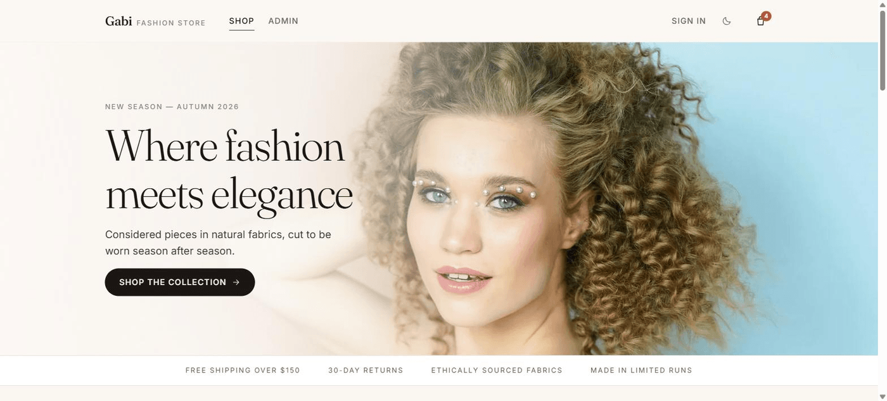
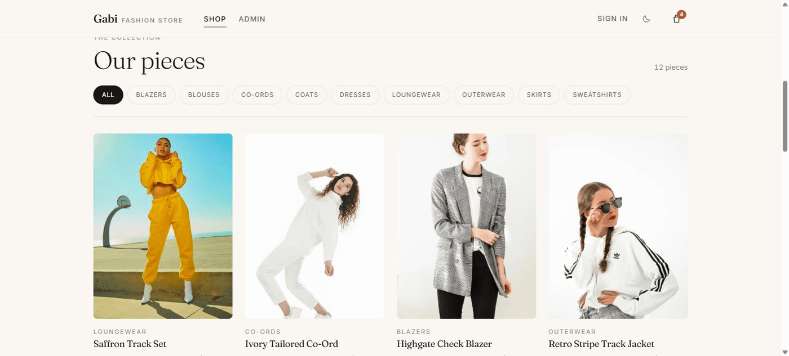
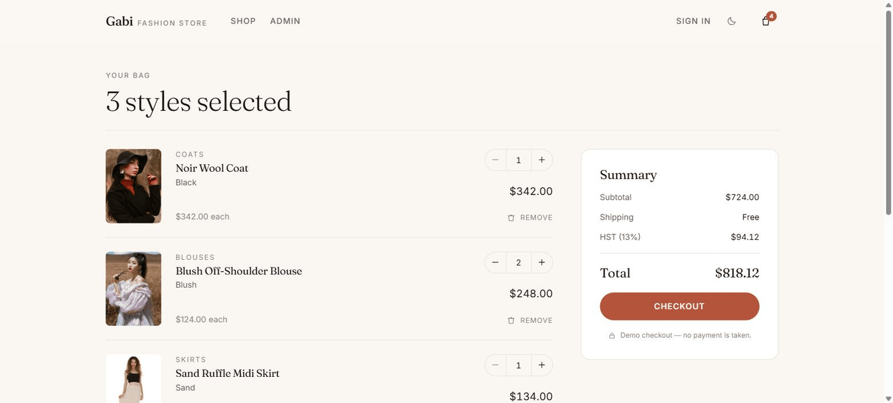
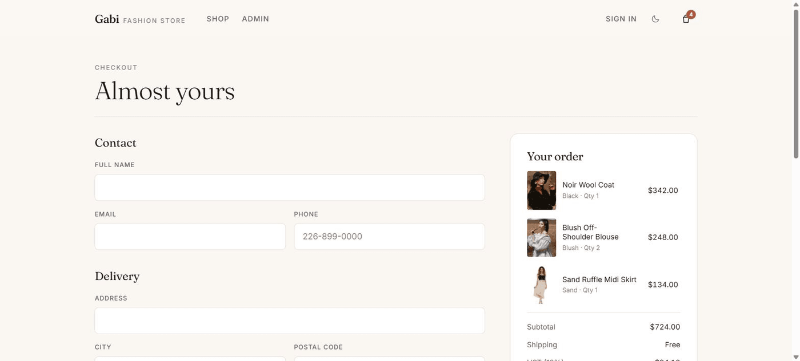
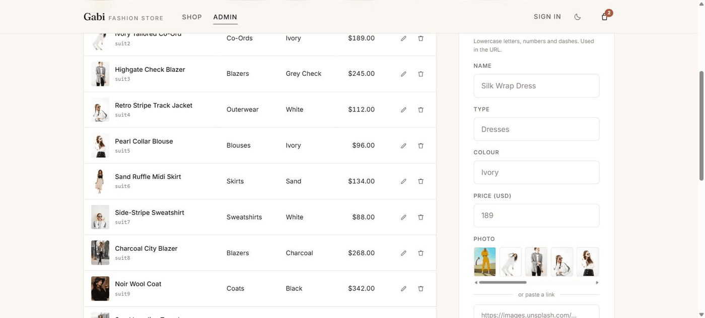
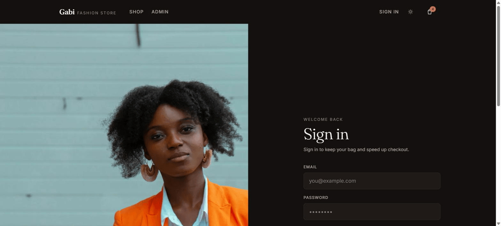
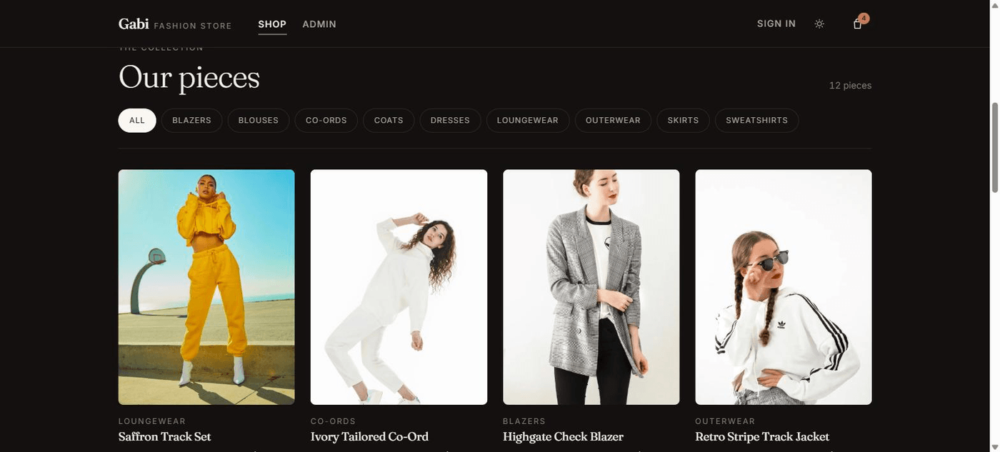
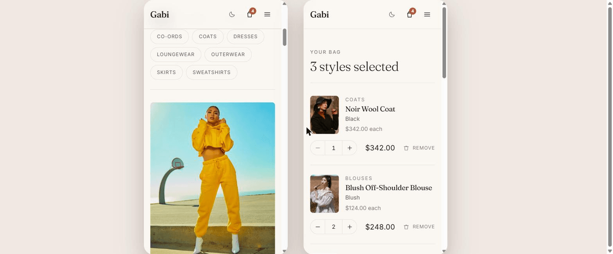

<div align="center">

# Gabi Fashion Store

**A full-stack demo boutique — React 18 + Vite on the front, Express + MongoDB behind it.**

Product catalogue, persistent cart, checkout with real validation, hashed-password auth,
and an admin panel over the REST API. Light and dark themes, responsive to 360px.

[Features](#features) · [Screenshots](#screenshots) · [Run it locally](#run-it-locally) · [API](#api-reference) · [Architecture](#architecture)

</div>

---



## Features

**Storefront**
- Catalogue fetched from the API, with loading skeletons, an error state and an empty state
- Client-side category filtering derived from the data
- Cart persisted to `localStorage`, so it survives a refresh and a closed tab
- Totals computed in integer cents — no floating-point drift in the subtotal, tax or total
- Free shipping over $150, with a prompt showing how much more is needed

**Checkout**
- Inline field validation on blur and on submit, with focus moved to the first error
- Luhn checksum on the card number and a real expiry-date check
- Order confirmation with a reference, delivery window and totals

**Accounts**
- Registration and sign-in against the API
- Passwords hashed with bcrypt and excluded from every query by default
- Login returns the same message for an unknown email as for a wrong password

**Admin** (`/admin`)
- Table of the live catalogue with create, edit and delete
- Confirmation dialog before deleting
- Exercises every product endpoint

**Design**
- One accent colour and a single token system (`client/src/styles/tokens.css`)
- Light and dark themes with a toggle in the nav; defaults to the OS preference
- Responsive from 360px up, with a slide-down nav drawer on small screens
- Keyboard-accessible: skip link, visible focus rings, `aria-invalid` + `aria-describedby` on fields
- Respects `prefers-reduced-motion`

**Browsing works without a backend** — if the API is unreachable, the storefront falls back
to a bundled demo catalogue and says so, so the front end can be deployed on its own.
Accounts and the admin panel still need the API.

## Screenshots

| Product grid | Shopping bag |
|---|---|
|  |  |

| Checkout | Admin panel |
|---|---|
|  |  |

| Sign in (dark) | Catalogue (dark) |
|---|---|
|  |  |

<div align="center">
  
</div>

## Tech stack

| | |
|---|---|
| **Front end** | React 18, React Router 6, Vite 6, CSS Modules, axios |
| **Back end** | Node.js, Express 4, Mongoose 8, bcryptjs |
| **Database** | MongoDB |
| **Testing** | `node:test`, supertest, mongodb-memory-server |

## Run it locally

**Requirements:** Node.js 20 or newer. MongoDB is only needed for the full stack — see the
two paths below.

```bash
git clone https://github.com/YOUR-USERNAME/gabi-fashion-store-ecommerce.git
cd gabi-fashion-store-ecommerce
```

### Option A — storefront only (no database, ~30 seconds)

The quickest way to look around. The storefront detects that the API is unreachable and
serves the bundled demo catalogue, so browsing, the cart and checkout all work.

```bash
cd client
npm install
npm run dev
```

Open **http://localhost:5173**. A notice at the top of the catalogue explains that the demo
data is in use. Sign-in reports "Could not reach the server" and the admin page shows a
"Could not reach the API" state — everything else works.

### Option B — full stack (React + Express + MongoDB)

You need MongoDB: either running locally, or a free
[MongoDB Atlas](https://www.mongodb.com/atlas/database) connection string.

**1. Start the API** — in one terminal:

```bash
cd server
npm install
cp .env.example .env     # then open .env and set MONGO_URI
npm run seed             # loads the 12-piece catalogue into the database
npm run dev              # http://localhost:8080
```

You should see `Connected to MongoDB.` followed by `API listening on http://localhost:8080`.
Check it with `curl http://localhost:8080/api/health`.

`server/.env`:

| Variable | Default | Purpose |
|---|---|---|
| `MONGO_URI` | — | MongoDB connection string (required) |
| `PORT` | `8080` | Port the API listens on |
| `CORS_ORIGIN` | `http://localhost:5173` | Comma-separated list of allowed origins |

**2. Start the storefront** — in a second terminal:

```bash
cd client
npm install
cp .env.example .env     # optional — defaults to http://localhost:8080
npm run dev              # http://localhost:5173
```

Open **http://localhost:5173**.

### What to try

- **Shop** — filter by category, add a few pieces to the bag
- **Bag** — change quantities, then reload the page; the bag is still there
- **Checkout** — submit it empty to see the inline validation, then pay with the test card
  `4242 4242 4242 4242`, any future expiry and any 3 digits. Nothing is charged.
- **Sign up** — create an account, sign out, sign back in
- **Admin** (`/admin`) — add, edit and delete a product against the live API
- **Theme** — the sun/moon button in the nav; it follows your OS setting by default

### Troubleshooting

| Symptom | Fix |
|---|---|
| "Showing the bundled demo catalogue — the API is not reachable" | The API is not running. Start it with `npm run dev` in `server/`. |
| "…the API is running but has no products yet" | Run `npm run seed` in `server/`. |
| `Missing MONGO_URI` on startup | Copy `server/.env.example` to `server/.env` and set the connection string. |
| MongoDB connection error | Confirm MongoDB is running, or that your Atlas IP allowlist includes your address. |
| CORS error in the browser console | Add the storefront's origin to `CORS_ORIGIN` in `server/.env`. |

### Scripts

| Directory | Command | Does |
|---|---|---|
| `server` | `npm run dev` | Start the API with nodemon |
| `server` | `npm start` | Start the API |
| `server` | `npm run seed` | Upsert the catalogue (`-- --fresh` wipes it first) |
| `server` | `npm test` | Run the API test suite |
| `client` | `npm run dev` | Vite dev server |
| `client` | `npm run build` | Production build to `dist/` |
| `client` | `npm run preview` | Serve the production build |
| `client` | `npm run lint` | ESLint |

## Tests

The API suite runs against an in-memory MongoDB, so it needs no local database:

```bash
cd server && npm test
```

17 tests covering product CRUD and validation, duplicate handling, bcrypt hashing,
login success and failure, and that no endpoint ever returns a password hash.

## API reference

Base URL `http://localhost:8080`.

### Products

| Method | Route | Description |
|---|---|---|
| `GET` | `/api/products` | List all products |
| `GET` | `/api/products/:productId` | Fetch one product |
| `POST` | `/api/products` | Create a product |
| `PUT` | `/api/products/:productId` | Update a product (the id itself is immutable) |
| `DELETE` | `/api/products/:productId` | Delete a product |

```bash
curl -X POST http://localhost:8080/api/products \
  -H "Content-Type: application/json" \
  -d '{"productId":"suit13","productName":"Silk Wrap Dress","productType":"Dresses","productColor":"Ivory","value":189}'
```

### Auth and users

| Method | Route | Description |
|---|---|---|
| `POST` | `/api/auth/register` | Create an account |
| `POST` | `/api/auth/login` | Verify credentials |
| `GET` | `/api/users` | List users (never includes passwords) |
| `GET` | `/api/users/:email` | Fetch one user |
| `PUT` | `/api/users/:email` | Update the user named in the URL |
| `DELETE` | `/api/users/:email` | Delete a user |

`GET /api/health` returns `{ "status": "ok" }`.

## Architecture

```
client/
├─ public/images/          12 product shots + 3 editorial images (WebP)
└─ src/
   ├─ components/          Navbar, Footer, ProductCard, Field, ToastStack, …
   ├─ context/             Cart, Auth, Theme, Toast providers
   ├─ data/                Static fallback catalogue
   ├─ hooks/useForm.js     Controlled forms with blur/submit validation
   ├─ lib/                 api.js (axios + fallback), money.js (cents), validation.js
   ├─ pages/               Home, Cart, Checkout, Login, Register, Admin, NotFound
   └─ styles/              tokens.css, global.css

server/
├─ config/db.js            Mongoose connection
├─ data/products.js        Catalogue seed data
├─ middleware/             asyncHandler, notFound, errorHandler
├─ models/                 Product, User (bcrypt pre-save hook)
├─ routes/                 products, users, auth
├─ tests/api.test.js       Integration tests
├─ app.js                  Express app (exported for tests)
├─ seed.js                 Catalogue seeder
└─ server.js               Entry point
```

**A few decisions worth noting**

- **Money in cents.** Prices are stored as dollars but every total is summed as integer
  cents (`client/src/lib/money.js`), because `128 + 124.5` in floats reaches the UI as
  `252.49999999999997`.
- **The cart stores a snapshot.** Only the fields the cart renders are saved, so editing a
  product in the admin panel cannot reshape someone's saved cart.
- **`app.js` is separate from `server.js`.** The Express app is exported without calling
  `listen`, which is what lets supertest mount it directly.
- **Passwords are `select: false`.** They have to be asked for explicitly, so no route can
  leak a hash by forgetting to exclude it.

## Deployment

The client builds to a static bundle and includes SPA-rewrite config for both
Netlify (`public/_redirects`) and Vercel (`vercel.json`).

```bash
cd client && npm run build      # → client/dist
```

Deploy `client/dist` anywhere static. Set `VITE_API_URL` to your deployed API, or leave it
unset and the demo catalogue will be served. For the API, set `MONGO_URI` and `CORS_ORIGIN`
on your host of choice.

## Credits

- Photography from [Unsplash](https://unsplash.com/s/photos/woman-clothes-style?license=free)
- Typefaces: [Fraunces](https://fonts.google.com/specimen/Fraunces) and [Inter](https://fonts.google.com/specimen/Inter)

Originally built for the Web Development course of my Mobile Solutions postgraduate program,
then rebuilt as a portfolio piece.

## License

[MIT](LICENSE) © Gabriela Nascimento Oliveira Pereira
